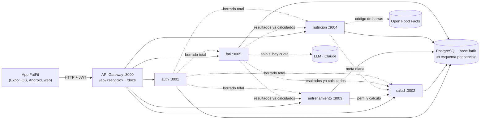
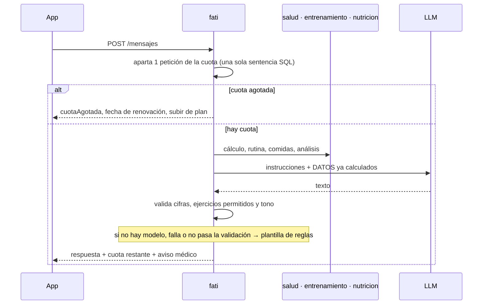

# FatFit — Backend

Microservicios de FatFit con **NestJS 12 (TypeScript)** y **PostgreSQL 16**. Cada servicio publica su documentación con **Swagger**, así que todo se prueba desde el navegador, sin Postman.

Cubre las fases 1 a 3 del proyecto: registro y roles, perfil, cálculo base y rutinas; alimentos, análisis y seguimiento; Fati con cuotas y planes.

## Arquitectura



| Servicio | Puerto | Esquema | Qué hace |
|---|---|---|---|
| gateway | 3000 | — | Única entrada para el front. Reenvía `/api/<servicio>/…` y junta todos los Swagger en `/docs`. |
| auth | 3001 | `auth` | Registro con consentimiento explícito, login, JWT, roles, recuperación de contraseña, borrado total de la cuenta. |
| salud | 3002 | `salud` | Perfil inicial, historial de peso y **motor de reglas**: IMC, Mifflin-St Jeor, gasto diario, meta con mínimo seguro, macros. |
| entrenamiento | 3003 | `entrenamiento` | Catálogo de ejercicios, **motor de rutinas** (filtra por tiempo, equipo, nivel y contraindicaciones), sesiones y racha. |
| nutricion | 3004 | `nutricion` | Catálogo de alimentos (propio + Open Food Facts por código de barras), registro de comidas y **análisis** con sustitutos. |
| fati | 3005 | `fati` | Planes, suscripción, **cuota de IA validada en el servidor**, chat con Fati y validación de la respuesta del modelo. |

**Cómo se reparte la responsabilidad**

- Cada servicio es dueño de su esquema; no hay llaves foráneas entre esquemas. Lo que los une es el `usuario_id` que viaja en el JWT.
- Todos validan el JWT por su cuenta con el secreto compartido, así que funcionan igual detrás del gateway o directo en su puerto.
- Cuando un servicio necesita datos de otro, lo llama por HTTP reenviando el token del usuario, y el otro aplica sus mismas reglas de acceso.
- Los cálculos viven en funciones puras con pruebas unitarias (`apps/*/src/motor/`). Fati no calcula: recibe los resultados y solo redacta.

### Flujo de una pregunta a Fati



## Puesta en marcha

Requisitos: Node 20.19 o superior y Docker.

```bash
npm install
cp .env.example .env        # y cambia JWT_SECRETO y CLAVE_INTERNA
npm run db:levantar         # PostgreSQL en Docker (puerto 5433) con esquema y semillas
npm run dev                 # los 6 servicios en modo desarrollo
```

Abre **http://localhost:3000/docs** y elige el servicio en el selector de arriba a la derecha. Cada servicio también tiene su Swagger propio en `http://localhost:<puerto>/docs`.

Para probar con sesión: ejecuta `POST /login` en **Auth**, copia `tokenAcceso`, pulsa **Authorize** y pégalo. El gateway recuerda el token al cambiar de servicio.

| Cuenta de prueba | Contraseña | Rol |
|---|---|---|
| `ana@fatfit.mx` | `Ana12345` | usuario (la usuaria de ejemplo del front, con perfil y pesos) |
| `admin@fatfit.mx` | `Admin1234` | admin |

Otros comandos:

| Comando | Para qué |
|---|---|
| `npm test` | Pruebas unitarias de los motores de reglas |
| `npm run typecheck` | Revisión de tipos de todo el repositorio |
| `npm run build` y `npm start` | Compilar y ejecutar sin modo desarrollo |
| `npm run dev:salud` (o `dev:auth`, …) | Un solo servicio |
| `npm run db:aplicar` | **Borra todos los datos** y vuelve a aplicar esquema y semillas |
| `npm run db:psql` | Consola SQL |

Sin Docker: crea una base en tu PostgreSQL, ejecuta `db/01_esquema.sql` y `db/02_semillas.sql` con `psql`, y pon su URL en `DATABASE_URL`. Con Docker Compose también sirve `docker compose up -d`.

### Fati con o sin modelo

Sin `ANTHROPIC_API_KEY` en `.env`, Fati contesta con plantillas armadas con los cálculos; todo lo demás (cuotas, historial, validación) funciona igual. Con la llave, redacta el modelo indicado en `FATI_MODELO` y cada pregunta tiene costo en la cuenta de Anthropic.

## Estructura

```
db/                     01_esquema.sql · 02_semillas.sql · db.sh
libs/comun/src/         JWT y roles, Swagger, conexión, llamadas entre servicios, fechas
apps/gateway/src/       proxy y Swagger unificado
apps/<servicio>/src/
  main.ts               arranque
  *.module.ts           módulo
  *.controller.ts       rutas (lo que se ve en Swagger)
  *.service.ts          lógica y acceso a datos
  *.entity.ts           tablas
  *.dto.ts              validación de entradas
  motor/                reglas puras + pruebas (*.spec.ts)
```

Las tablas se crean con los scripts de `db/`, no desde el código (`synchronize` está apagado): si cambias una tabla, cambia el SQL y la entidad.

## Reglas de seguridad ya aplicadas

- Contraseñas con bcrypt; tokens de refresco y recuperación de un solo uso, guardados como hash.
- Cada consulta filtra por el usuario del token: nadie lee datos de otra persona. El rol `admin` administra cuentas, planes y catálogos y solo ve métricas agregadas.
- La meta nunca baja del mínimo calórico seguro; embarazo, cardiopatía, diabetes o IMC extremo generan la recomendación de consulta médica desde el primer día.
- La cuota de Fati se valida y descuenta en el servidor, con una sentencia atómica.
- La respuesta del modelo se descarta si cita calorías que el servidor no calculó, ejercicios fuera de la rutina filtrada o lenguaje de culpa.
- Eliminar la cuenta borra los datos en todos los servicios antes de borrar el usuario.

## Pendiente (fases 4 y 5 y decisiones abiertas)

- Profesionistas: verificación, asignación, permisos compartidos, mensajería y bitácora de accesos. El rol ya existe, las tablas todavía no.
- Alerta del primer mes y notificaciones push (el umbral ya está en `fati.configuracion`).
- Panel de administración completo y fotos de progreso.
- Pagos reales: el cambio de plan es inmediato y está simulado; falta Stripe / RevenueCat. Los precios de las semillas son provisionales.
- Envío de correos: la recuperación de contraseña devuelve el token en la respuesta mientras no sea producción.
- Seguridad a nivel de fila en PostgreSQL y cifrado en reposo: hoy el aislamiento lo aplica cada servicio en sus consultas.
- Conectar el front: sustituir `src/data/mock.ts` y `src/store.tsx` por llamadas a `http://localhost:3000/api`.
